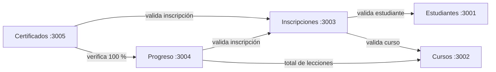

# 🎓 mini-Udemy — Plataforma de cursos con microservicios

**Curso:** Cloud Computing — Universidad Continental
**Producto académico N.º 3** — Actividad grupal

## 👥 Integrantes

| Integrante | Rol | Microservicio |
|------------|-----|---------------|
| @JhimyMc | Líder | Estudiantes |
| @Luis Cristian Rafaele Huaman | Desarrollador | Cursos |
| @Daniel Benjamin Quispirroca Benitez | Desarrollador | Inscripciones |
| @Edwards Andree Ochoa Cutipa | Desarrollador | Progreso |
| @Urpi Radhakrina Pilco Del Alamo | Desarrollador | Certificados |

## 📖 Introducción

En las provincias de la región **Cusco**, muchos jóvenes quieren capacitarse para conseguir mejores oportunidades de trabajo, pero la oferta de cursos se concentra en la ciudad, la conexión a Internet suele ser limitada y, al terminar un curso, no tienen una constancia que puedan mostrar a un empleador.

**mini-Udemy** es una plataforma de cursos en línea, ligera y pensada para usarse desde el celular, donde el estudiante:

1. Se registra.
2. Elige un curso y se inscribe.
3. Avanza lección por lección.
4. Al completar el 100 %, obtiene un **certificado** con un código único.

El sistema está construido con una **arquitectura de microservicios**: cada servicio es independiente, tiene su propia base de datos y se comunica con los demás por HTTP. Se ejecuta con **Docker Compose** y se valida automáticamente con **GitHub Actions**.

## 🧩 Microservicios

| Microservicio | Puerto | Responsabilidad | Se comunica con |
|---------------|--------|-----------------|-----------------|
| **Estudiantes** | 3001 | Registrar y consultar estudiantes | — |
| **Cursos** | 3002 | Catálogo de cursos y número de lecciones | — |
| **Inscripciones** | 3003 | Inscribir a un estudiante en un curso | Estudiantes, Cursos |
| **Progreso** | 3004 | Registrar lecciones completadas y calcular el % de avance | Inscripciones, Cursos |
| **Certificados** | 3005 | Emitir el certificado cuando el progreso llega al 100 % | Inscripciones, Progreso |

**Tecnologías:** Node.js + Express · PostgreSQL · Docker · Docker Compose · Jest + Supertest · GitHub Actions

**Evidencias**
**Jhimy Mc**
Protección de Roles para el PR 

Colaboradores Equipo

Pruebas del primer Test de Estudiantes 

PR2

Automatizado con CI para la autoverificación con Action

**Evidencias**
**Cristian-> Luis-sketch993**
Figura 1. Creación de la rama feature/cursos 

Se evidencia la creación correcta de la rama feature/cursos, destinada al desarrollo independiente del microservicio Cursos, manteniendo la rama main como base del proyecto. 

Figura 2. Verificación de la conexión entre Docker Desktop y Ubuntu 

Se comprueba que Docker está operativo desde Ubuntu mediante la visualización de los contenedores activos. 

Figura 3. Primer commit del microservicio Cursos 

Se registra el primer avance del microservicio Cursos, incluyendo la estructura inicial, la conexión a PostgreSQL, las dependencias y la configuración de Docker. 

Figura 4. Despliegue del microservicio Cursos mediante Docker Compose 

Se evidencia la construcción de la imagen Docker, la inicialización de PostgreSQL y el inicio correcto del contenedor del microservicio Cursos. 

Figura 5. Verificación de los registros iniciales en PostgreSQL.

Se evidencia la creación de la tabla cursos y la inserción de los tres registros iniciales definidos en el script init.sql. 

Figura 6. Segundo commit del microservicio Cursos 

Se evidencia la incorporación del script SQL para la creación y carga inicial de cursos, junto con la implementación de los endpoints y validaciones de la API REST. 

Figura 7. Ejecución satisfactoria de las pruebas automatizadas del microservicio Cursos 

Se evidencia la ejecución de siete pruebas mediante Jest y Supertest, todas aprobadas, verificando los endpoints, las validaciones y el registro de cursos. 

Figura 8. Pull Request del microservicio Cursos hacia el repositorio central 

Pull request enviado a la rama central , para su revision respectiva

Evidencias de aprobacion y revision:

 
 
 

